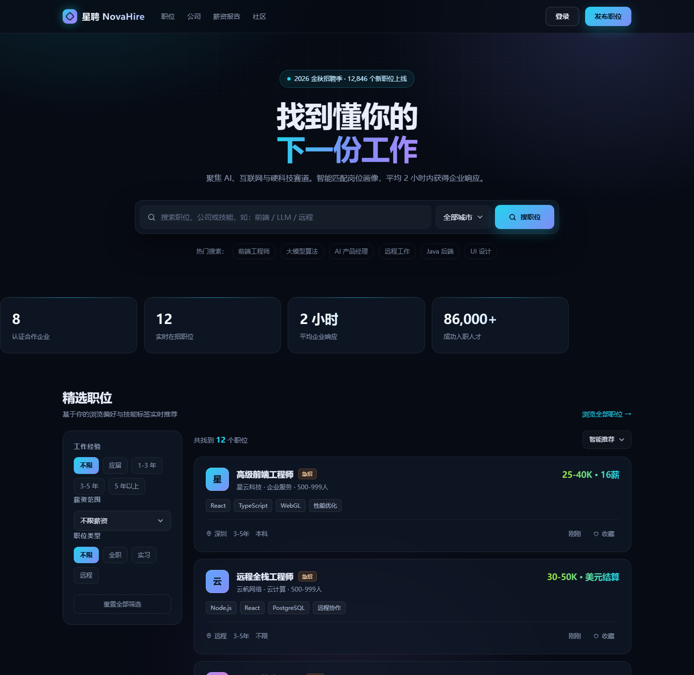

# 星聘 NovaHire

求职招聘平台前台 + Spring Boot 3 后端，构建产物为可部署的 `novahire.war`。

> 本项目仅用于学习与演示，免费用于非商业用途，禁止商用。详见[许可与使用限制](#许可与使用限制)。



## 下载

- 最新 WAR 包：[GitHub Releases](https://github.com/derek960629-afk/novahire-job-portal/releases/latest)
- 在线预览：部署 WAR 后访问 `/novahire/`

## 许可与使用限制

本项目采用 **PolyForm Noncommercial License 1.0.0**（非商业许可）：

- **允许**：个人学习、研究、实验、业余项目、教学，以及慈善、教育、公共研究、公共安全/健康、环保、政府机构等非商业用途；可修改和分发。
- **禁止**：任何商业用途，包括但不限于企业内部生产使用、SaaS 或收费服务、外包与定制交付、商业产品集成、招聘平台运营、付费培训、以盈利为目的的二次分发。
- **分发条件**：分发时必须附带本许可条款与 `Required Notice`。
- **商用授权**：需取得作者书面授权，可通过 GitHub Issues 联系。
- **术语说明**：由于限制商业用途，本许可不属于 OSI（开放源码促进会）定义的开源许可，准确表述为 **source-available（源码公开）**。

完整法律条款见 [LICENSE](LICENSE)，以英文原文为准。

## 目录结构

```
job-portal/
├─ index.html                 # 前端页面（同时支持离线预览）
├─ docs/preview.png           # 页面预览图
├─ server/                    # Spring Boot 3 + MySQL 后端工程
│  ├─ src/main/java/com/novahire/
│  ├─ src/main/resources/application.yml      # 默认 MySQL 配置
│  ├─ src/main/resources/application-h2.yml   # H2 演示配置（无需 MySQL）
│  ├─ src/test/java/com/novahire/             # 集成测试
│  └─ pom.xml
└─ dist/
   └─ novahire.war            # 本地构建产物（不纳入 Git，发布在 GitHub Releases）
```

前端 `index.html` 在 Maven 构建时自动打入 WAR 的 `WEB-INF/classes/static/`，无需手动复制。

## 技术栈

- Java 17
- Spring Boot 3.3.5（Web、Data JPA、Validation）
- MySQL 8（默认），H2（演示/测试）
- 打包方式：WAR，可部署到 Tomcat 10.1+
- 前端：原生 HTML / CSS / JavaScript

## 快速体验（无需 MySQL）

已用便携 Tomcat 10.1 + H2 完成端到端验证。启动方式：

```bash
# 将 WAR 复制到 Tomcat 后，设置 H2 配置
set SPRING_PROFILES_ACTIVE=h2
%CATALINA_HOME%\bin\catalina.bat run
```

访问：`http://localhost:8080/novahire/`

> H2 为内存数据库，重启后数据恢复为种子数据，仅用于演示。
> 生产环境请使用 MySQL 配置。

## 使用 MySQL 部署

### 1. 创建数据库

```sql
CREATE DATABASE novahire DEFAULT CHARACTER SET utf8mb4 COLLATE utf8mb4_unicode_ci;
CREATE USER 'novahire'@'%' IDENTIFIED BY 'change-me';
GRANT ALL PRIVILEGES ON novahire.* TO 'novahire'@'%';
FLUSH PRIVILEGES;
```

表结构由 JPA 自动创建（`ddl-auto=update`）；首次启动会自动写入演示数据。生产环境建议改用 Flyway/Liquibase 管理表结构，并将 `ddl-auto` 改为 `validate`。

### 2. 配置环境变量

| 变量 | 默认值 | 说明 |
| --- | --- | --- |
| `DB_URL` | `jdbc:mysql://localhost:3306/novahire?...` | JDBC 连接串 |
| `DB_USERNAME` | `root` | 数据库用户名 |
| `DB_PASSWORD` | `root` | 数据库密码 |
| `SEED_DATA` | `true` | 是否写入演示数据 |
| `CORS_ORIGINS` | `*` | 允许跨域的来源，多个用逗号分隔 |
| `SERVER_PORT` | `8080` | 内置运行时的端口（外部 Tomcat 部署时以 Tomcat 为准） |

示例（Windows）：

```bat
set DB_URL=jdbc:mysql://127.0.0.1:3306/novahire?useUnicode=true&characterEncoding=utf8&serverTimezone=Asia/Shanghai&useSSL=false&allowPublicKeyRetrieval=true
set DB_USERNAME=novahire
set DB_PASSWORD=change-me
set SEED_DATA=false
```

### 3. 部署 WAR

1. 安装 JDK 17 与 Tomcat 10.1+（Jakarta EE 10）。
2. 将 `dist/novahire.war` 复制到 `%CATALINA_HOME%\webapps\`。
3. 启动 Tomcat，访问 `http://<host>:8080/novahire/`。
4. 健康检查：`http://<host>:8080/novahire/api/health`。

WAR 名称决定上下文路径；若希望部署在根路径，可将文件重命名为 `ROOT.war`。

### 4. 重新构建

```bash
cd server
mvn clean package
```

产物：`server/target/novahire.war`。

运行测试（使用 H2，不依赖 MySQL）：

```bash
mvn test
```

## API 一览

基础路径：`/api`（以 `/novahire` 上下文为例：`/novahire/api`）

| 方法 | 路径 | 说明 |
| --- | --- | --- |
| GET | `/jobs` | 职位列表，支持 `keyword`、`city`、`exp`、`type`、`salary`、`sort` |
| GET | `/jobs/{id}` | 职位详情 |
| POST | `/jobs` | 创建职位（企业发布，演示接口，无鉴权） |
| GET | `/companies` | 企业列表（含在招职位数） |
| GET | `/stats` | 平台统计 |
| GET | `/favorites` | 当前会话收藏的职位 ID |
| POST | `/favorites/{jobId}` | 收藏职位 |
| DELETE | `/favorites/{jobId}` | 取消收藏 |
| POST | `/applications` | 投递简历 |
| GET | `/applications?jobId=` | 查看某职位投递记录（演示接口，无鉴权） |
| GET | `/health` | 健康检查 |

`sort` 取值：`recommend`（默认）、`latest`、`salary`。
`salary` 取值：`0-15`、`15-25`、`25-40`、`40+`。

示例：

```bash
curl "http://localhost:8080/novahire/api/jobs?keyword=大模型&city=北京&sort=salary"
```

```bash
curl -X POST "http://localhost:8080/novahire/api/applications" \
  -H "Content-Type: application/json" \
  -d '{"jobId":1,"name":"张三","email":"zhangsan@example.com","phone":"13800000000","resumeUrl":"https://example.com/cv.pdf"}'
```

收藏基于浏览器会话（`JSESSIONID`），同一浏览器内持久；清除 Cookie 后收藏失效。

## 前端说明

- 通过 WAR 访问时自动调用同源 `/api/*`。
- 直接双击 `index.html`（`file://`）时会自动回退到内置演示数据，收藏仅保存在 `localStorage`。
- 投递表单会调用后端接口；离线预览模式下不会真正提交。

## 安全说明

当前为可运行的演示版本，未包含登录鉴权、权限控制、限流与 CSRF 防护。正式上线前至少需要：

- 引入 Spring Security（求职者 / 企业 / 管理员角色）
- 为 `/api/jobs` 的创建、`/api/applications` 的查询增加鉴权
- 配置 HTTPS、数据库最小权限账号、请求限流
- 使用 Flyway 管理数据库版本，关闭 `ddl-auto=update`
- 对用户提交内容做 XSS/SQL 注入校验（JPA 已参数化，但仍需输出转义）

## 风险说明与免责声明

> 以下内容仅为风险提示，不构成法律意见。正式商用、公开运营或处理真实个人信息前，请咨询专业律师并完成合规评估。

### 1. 演示数据

职位、企业、薪资、统计数字、企业标识等均为虚构或示例数据，仅用于界面展示，不构成任何真实招聘、薪资或就业承诺。

### 2. 个人信息与合规

投递表单会收集姓名、邮箱、手机号、简历链接等信息。当前版本：

- 未提供隐私政策、告知同意、数据删除与导出机制；
- 未对简历数据加密存储或做访问审计；
- 收藏依赖会话 Cookie，投递记录默认长期保存。

如用于真实业务，必须遵守《个人信息保护法》《网络安全法》等适用法律，落实最小必要、告知同意、加密存储、访问控制、留存期限与删除机制。

### 3. 安全风险

- 默认无登录鉴权、角色权限、限流、CSRF 防护与审计日志；
- `application.yml` 中数据库账号密码为示例值，生产环境必须通过环境变量或密钥管理覆盖；
- 演示部署默认使用 HTTP，生产环境必须启用 HTTPS；
- 管理类接口（创建职位、查询投递记录）当前无鉴权，禁止直接暴露到公网。

### 4. 第三方依赖许可

项目依赖的第三方组件有各自许可证，例如 Spring Boot / Tomcat（Apache-2.0）、H2（MPL-2.0 / EPL-1.0）、MySQL Connector/J（GPLv2 + FOSS Exception）。本项目的非商业限制不改变第三方许可证的约束。分发或商用前请自行核对全部依赖的许可义务。

### 5. 无担保与责任限制

软件按“现状”提供，不附带任何明示或默示担保，包括但不限于适销性、特定用途适用性与不侵权担保。在法律允许的最大范围内，作者不对因使用或无法使用本项目造成的任何直接、间接、附带或后果性损失承担责任。

### 6. 商标与内容

“星聘 / NovaHire”为演示名称，不表示任何真实企业或商标。页面中的企业名称、Logo、职位描述均为虚构；如引入第三方商标、图片或字体，请自行取得授权。

### 7. 商用限制

未经作者书面许可，不得将本项目或其衍生作品用于任何商业目的。违反许可的，授权自动终止。
